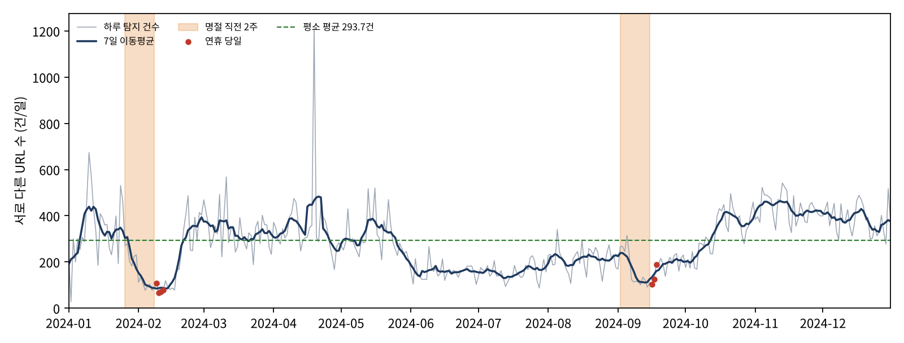

# 명절 연휴 직전 피싱사이트 탐지량의 변화

**2024년 한국인터넷진흥원(KISA) 공개 자료 131,752건으로 본 "명절 스미싱 경고"의 검증**

📄 논문: [`paper.pdf`](paper.pdf)

## 한 줄 결론
명절 직전에 피싱이 늘어난다는 경고는 **2024년 KISA 탐지 자료에서는 확인되지 않았습니다.** 명절 직전 2주의 하루 평균 탐지 건수는 설 156.1건, 추석 167.8건으로 평소(293.7건)의 절반 수준이었습니다.

| 구간 | 하루 평균(서로 다른 URL) | 평소 대비 | 연중 14일 구간 320개 중 순위 |
|---|---|---|---|
| 평소 (331일) | 293.7 | 1.00 | — |
| 설 직전 2주 (1/26~2/8) | 156.1 | 0.53 | 306위 |
| 추석 직전 2주 (9/2~9/15) | 167.8 | 0.57 | 270위 |



## 연구 방식
- 가설·측정 정의·판정 기준을 **데이터를 열기 전에** 문서로 고정했습니다 → [`01_가설과_설계_사전확정.md`](01_가설과_설계_사전확정.md)
- 참고문헌은 모두 원문 주소를 직접 열어 확인했습니다 → [`02_참고문헌과_확인기록.md`](02_참고문헌과_확인기록.md)
- 설계는 분석 도중 바꾸지 않았습니다 → [`03_설계_변경_기록.md`](03_설계_변경_기록.md)
- AI에게 맡긴 일과 직접 판단한 일 → [`AI와_나의_판단_3줄.md`](AI와_나의_판단_3줄.md)

## 파일
| 파일 | 내용 |
|---|---|
| `paper.pdf`, `paper.html` | 논문 |
| `data/kisa_phishing_20241231.csv` | 원자료(공공데이터포털에서 받은 파일 그대로, 131,752행) |
| `analysis.py` | 사전 확정 판정 실행(표준 라이브러리만) |
| `explore.py` | 해석용 사후 확인(판정에 쓰지 않음) |
| `make_figure.py` | 그림 생성(matplotlib 필요) |
| `out/` | 실행 결과(`report.json`, `daily_counts.csv`, `windows_*.csv`, `explore.json`, `figure1.png`) |

## 원자료
- 한국인터넷진흥원_피싱사이트_20241231, 공공데이터포털 https://www.data.go.kr/data/15143094/fileData.do (이용허락범위 제한 없음)
- 받은 날짜 2026-10-28 · SHA-256 `3e7341b501f16d8cb25e638ec4e276bfa474fd41153c053e7b47af9fc109deec`

## 다시 실행하기 (Python 3.9 이상)
```
python analysis.py data/kisa_phishing_20241231.csv
python explore.py
python make_figure.py
```
첫 명령 출력에 `"rows_read": 131752`, 설 `"rank": 306`, 추석 `"rank": 270`, `"verdict": "기각"`이 나오면 논문과 같은 결과입니다.

## 한계
날짜는 유포일이 아니라 KISA 탐지일이고, 문자 수가 아니라 사이트 수이며, 2024년 한 해(명절 2회)만 보았습니다. 자세한 내용은 논문 Ⅴ장을 참고하세요.
